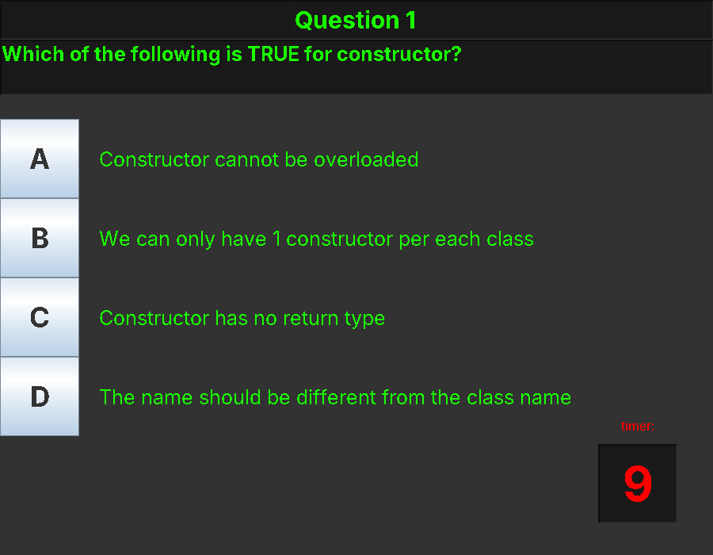

# Java Trivia Quiz

A small quiz game I made with my classmate Jeffrey Wang for our final project in CSCI 185 (Computer Programming II) in Spring 2024. It's written in Java using Swing.



The quiz has 11 multiple choice questions about Java and OOP, mostly things we covered in class like constructors, inheritance, abstract classes and exceptions. You get 10 seconds per question. After you answer (or time runs out) the wrong options turn red so you can see which one was right, and then it moves on to the next question.

At the end it shows your score and percentage, and asks you to leave some feedback before closing. If the feedback is too short it throws a custom exception (`NotEnoughCharactersException`) and asks you to write more. We added that part mainly to practice exception handling.

I worked on the GUI, the button events and the timer. Jeffrey did the question logic, checking answers and the scoring.

## Running it

You need Java installed. Then:

```
git clone https://github.com/<your-username>/java-trivia-quiz.git
cd java-trivia-quiz/src
javac Quiz/*.java
java Quiz.QuizGame
```

You can also just open it in IntelliJ or Eclipse and run `QuizGame`.

## Files

- `src/Quiz/QuizGame.java` has the whole game (window, questions, timer, results)
- `src/Quiz/NotEnoughCharactersException.java` is the custom exception for the feedback box
